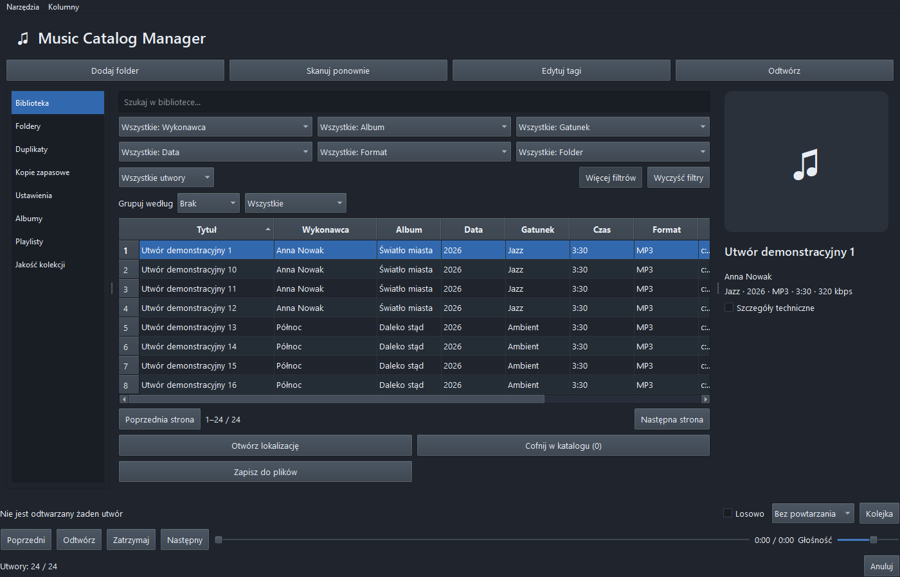
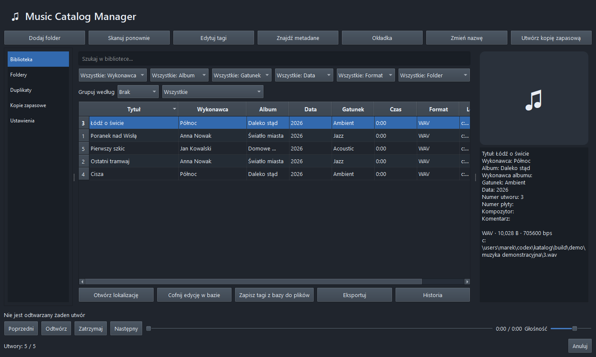

# Music Catalog Manager 0.4.0

Lokalny katalog muzyki z odtwarzaczem dla Windows 10/11 x64, Python 3.12 i Qt/PySide6. Nie wymaga konta ani dostępu do internetu do katalogowania i odtwarzania własnych plików. Nie pobiera muzyki.

## Pliki wydania

Wydanie Windows 10/11 x64:

- [Instalator Windows 0.4.0](https://github.com/zetmar-collab/music-catalog-manager/releases/download/v0.4.0/MusicCatalogManager-0.4.0-Setup.exe)
- [Wersja przenośna ZIP](https://github.com/zetmar-collab/music-catalog-manager/releases/download/v0.4.0/MusicCatalogManager-0.4.0-portable.zip)
- [Kod źródłowy ZIP](https://github.com/zetmar-collab/music-catalog-manager/releases/download/v0.4.0/MusicCatalogManager-0.4.0-source.zip)
- [Pomoc PL](https://github.com/zetmar-collab/music-catalog-manager/releases/download/v0.4.0/MusicCatalogManager-0.4.0-Help-PL.html) · [Help EN](https://github.com/zetmar-collab/music-catalog-manager/releases/download/v0.4.0/MusicCatalogManager-0.4.0-Help-EN.html)
- [Wydanie i sumy SHA-256](https://github.com/zetmar-collab/music-catalog-manager/releases/tag/v0.4.0)

Archiwalne wydania: [0.2.0](https://github.com/zetmar-collab/music-catalog-manager/releases/tag/v0.2.0), [0.1.0](https://github.com/zetmar-collab/music-catalog-manager/releases/tag/v0.1.0).



## Uruchomienie

Gotowy program: `dist\MusicCatalogManager\MusicCatalogManager.exe`. Cały folder jest potrzebny do uruchomienia wersji przenośnej. Instalator: `dist\MusicCatalogManager-0.4.0-Setup.exe`. Aktualizacja zachowuje dotychczasową bibliotekę i ustawienia; migruje schemat bazy 1 → 2. Wersja 0.2.0 nie otworzy profilu po migracji. Przed aktualizacją wykonaj kopię katalogu.

Ze źródeł, w PowerShell w katalogu projektu:

```powershell
py -3.12 -m venv .venv
.venv\Scripts\python.exe -m pip install -e '.[dev]'
.venv\Scripts\python.exe -m music_catalog_manager.main
```

Do pracy na oddzielnym profilu:

```powershell
.venv\Scripts\python.exe -m music_catalog_manager.main --profile .\profil-testowy
```

Dane domyślnie trafiają do `%LOCALAPPDATA%\MusicCatalogManager`. Kod i pliki instalacyjne są oddzielone od biblioteki użytkownika. Nie uruchamiaj dwóch instancji na tym samym profilu podczas przywracania kopii. Program zawiera blokadę pojedynczego profilu.

## Nowości 0.4.0

- **Grupuj według → Playlista**: wybierz zapisaną listę w drugim polu. Wpisy są pokazywane w kolejności playlisty, również powtórzenia; filtr działa ze stronicowaniem i eksportem. Grupowanie znajduje się pod **Więcej filtrów**.
- **Narzędzia / Playlisty → Importuj playlisty z folderu**: wyszukuje listy w folderze głównym i podfolderach. Można wybrać pliki oraz najpierw skatalogować audio z tego obszaru. Raport podaje dopasowane i brakujące ścieżki oraz błędy poszczególnych list. Ponowny import tej samej ścieżki aktualizuje jej listę. Obsługiwane importy: M3U, M3U8, PLS, WPL, XSPF (eksport nadal M3U/M3U8).
- **Wyszukaj okładkę w internecie**: wykonawca albumu i tytuł są uzupełniane z tagów i można je poprawić. Wyszukiwanie MusicBrainz + Cover Art Archive pokazuje do 8 różnych podglądów, z wyborem miejsca zapisu. Nie wymaga wpisywania MBID. Dla tej funkcji domyślny kontakt User-Agent wskazuje prawdziwą stronę tego projektu; własny kontakt z Ustawień ma pierwszeństwo.
- **Wybierz obraz z dysku**: osobne polecenie w panelu szczegółów, menu Narzędzia i menu kontekstowym. JPEG/PNG, limit 20 MiB i 25 mln pikseli, podgląd i te same miejsca zapisu co dla internetu.
- **Pomoc → Instrukcja użytkownika / F1**: obszerna pomoc offline PL/EN z przełączaniem języka. Pliki: [pomoc PL](src/music_catalog_manager/resources/help-pl.html), [help EN](src/music_catalog_manager/resources/help-en.html). Są dołączone do EXE i instalatora.
- Baza pozostaje w schemacie 2; aktualizacja z 0.3.0 nie wymaga nowej migracji.

## Funkcje dodane w 0.3.0

- Biblioteka ładuje strony po 250 rekordów. Wyszukiwanie, filtry i sortowanie wykonuje SQLite w tle. Wpisywanie ma opóźnienie 250 ms; przestarzałe zapytania są anulowane i scalane.
- Szybkie widoki: brakujące tagi, bez okładki, zmiany do zapisania, niedostępne pliki. Aktywne filtry są widoczne obok przycisku **Wyczyść filtry**.
- **Narzędzia** i menu pod prawym przyciskiem zawierają operacje dodatkowe. **Kolumny** pozwalają ukrywać pola. Pozycja okna, kolumny, sortowanie i podział paneli są zapamiętywane. Przy małej wysokości włącza się układ kompaktowy: dodatkowe filtry rozwija przycisk **Więcej filtrów**, a operacje dolnego paska są w menu Narzędzia. Odtwarzacz pozostaje dostępny.
- **Albumy** pokazują okładki i liczbę utworów. Dwuklik otwiera album; rozróżniany jest wykonawca albumu.
- **Foldery** pokazują liczby utworów, dostępność plików i datę ostatniego skanowania. Można przeskanować lokalizację albo wskazać nową ścieżkę.
- **Playlisty** zapisują kolejność i powtórzenia. Można je odtwarzać, zmieniać kolejność przez przeciąganie, usuwać wpisy, importować i eksportować M3U/M3U8. Import dopasowuje wyłącznie pliki już obecne w katalogu; pokazuje niedopasowane ścieżki i pomija adresy strumieni.
- **Kolejka** pokazuje odtwarzane pozycje i umożliwia ich przestawianie oraz usuwanie. Dostępne są losowanie, powtarzanie utworu i powtarzanie kolejki.
- **Narzędzia → Metadane albumu**: zaznacz utwory jednego albumu, wybierz wydanie MusicBrainz i zatwierdź różnice. Dopasowanie używa numeru utworu/płyty albo jednoznacznego tytułu. Niedopasowane pliki pozostają bez zmian. Wyniki trafiają do katalogu; zapis audio jest osobnym krokiem.
- **Narzędzia → Tagi z nazwy pliku**: podaj np. `{tracknumber} - {artist} - {title}`. Podgląd pokazuje zmiany przed zapisem w katalogu. Wszystkie zaznaczone nazwy muszą pasować do szablonu.
- **Jakość kolekcji** raportuje brakujące tagi/okładki, niedostępne pliki, warianty pisowni wykonawców i braki/powtórzenia numeracji albumów. Możliwy jest eksport JSON. Raport nie zmienia plików.
- **Narzędzia → Porównaj nagrania**: kandydaci z biblioteki według wykonawcy, tytułu i różnicy czasu do 3 s; osobno porównanie 2–20 zaznaczonych plików audio. Porównanie audio lokalnie dekoduje pierwsze 60 sekund przez Qt, analizuje pasma częstotliwości w oknach i pokazuje wynik 0–100. To eksperymentalna sugestia, nie identyfikacja nagrania ani prawdopodobieństwo. Krótkie/ciche próbki mogą być niewystarczające. Program niczego nie usuwa.
- **Narzędzia → Przywróć oryginalne audio**: wybierz zarejestrowaną kopię, sprawdź ścieżkę i zatwierdź. SHA-256 weryfikuje kopię. Przed zastąpieniem powstaje kopia obecnego pliku. Przywracane są też tagi i okładka katalogu. Kopie audio wykonane przed 0.3.0 nie mają rejestru i nadal wymagają ręcznego przywrócenia.

## Korzystanie

1. **Dodaj folder**: wybierz katalog muzyki. Skan obejmuje podfoldery, pomija dowiązania i junction points. Pasek pokazuje pracę, a liczniki raportują nowe, zmienione, pominięte i błędne pliki. **Anuluj** zatrzymuje skan pomiędzy plikami; już dodane wpisy pozostają zapisane. Nie wykonuje zmian w audio.
2. **Skanuj ponownie**: wybierz wszystkie lub jedną lokalizację. Brakujący dysk nie usuwa wpisów. Identyfikator pliku umożliwia wykrycie zmiany nazwy lub przeniesienia na tym samym woluminie; przy włączonym SHA-256 także jednoznaczne dopasowanie przeniesionej kopii. Niepewne przypadki nie są scalane. **Foldery** pozwalają wskazać nową lokalizację całego katalogu.
3. Szukaj po tagach i ścieżce. Filtry zawężają wykonawcę, album, gatunek, datę, format i folder. Grupowanie wybiera grupę i porządkuje tabelę. Kliknięcie nagłówka sortuje. Zaznaczanie wielu pozycji: Ctrl/Shift. Szczegóły i okładka są po prawej.
4. **Duplikaty** pokazują wyłącznie zgodne SHA-256. Włącz obliczanie skrótów w Ustawieniach i przeskanuj ponownie. To porównanie całych plików, nie podobieństwa nagrania; różne tagi oznaczają różne skróty. Program niczego automatycznie nie usuwa.
5. **Edytuj tagi**: zmieniają się wyłącznie zaznaczone pola. Puste zaznaczone pole usuwa wartość. Domyślnie zapis obejmuje bazę. Zaznaczenie zapisu do audio jest wyraźną osobną opcją. Podgląd pokazuje zakres i wartości przed/po. **Zapisz tagi z bazy do plików** zapisuje pełny widoczny zestaw wybranych utworów, także identyfikatory pobrane z MusicBrainz. Przed każdym takim zapisem powstają kopie oryginałów.
6. **Cofnij edycję w bazie** cofa całą ostatnią operację edycji, również zbiorczą i po restarcie. Licznik wskazuje liczbę utworów. Historyczne edycje z wersji 0.2.0 cofają się pojedynczo. Nie cofa plików audio. Kopie oryginalnych audio są w `audio-backups` w profilu, z unikalnym prefiksem i oryginalną nazwą; kopie zarejestrowane w 0.3.0 można przywracać z menu Narzędzia, a starsze ręcznie po zamknięciu programu i sprawdzeniu ścieżki. W edytorze częściowego zapisu można wyłączyć wykonywanie tych kopii.
7. **Zmień nazwę**: pojedynczą nazwę wpisz jako zwykły tekst bez rozszerzenia. Dostępne są pola tagów oraz `{track:02}`, np. `{artist} - {title}`. Podgląd jest obowiązkowy. Znak niedozwolony zastępuje `_`; nazwy systemowe otrzymują prefiks. Kolizja przerywa całą operację przed pierwszym ruchem. Pliki pozostają w swoich folderach i zachowują rozszerzenia.
8. **Narzędzia → Eksportuj** zapisuje wszystkie wyniki aktualnego filtra, ze wszystkich stron do JSON lub CSV UTF-8. **Narzędzia → Historia** pokazuje ostatnie 200 operacji i szczegóły błędów.

## Odtwarzanie utworów

Dwuklik w tabeli albo przycisk **Odtwórz** uruchamia lokalny plik wskazany przez rekord bazy. Same dane audio pozostają na dysku. Dostępne są **Pauza**, **Zatrzymaj**, **Poprzedni**, **Następny**, suwak przewijania, licznik czasu i zapamiętywana głośność. W tabeli działa spacja oraz Enter; skróty nie przechwytują pisania w wyszukiwarce. Edytor tagów otwiera się przyciskiem **Edytuj tagi**.

Po rozpoczęciu odtwarzania przycisk **Odtwórz/Pauza** oraz spacja sterują aktualnym utworem. Aby uruchomić inną zaznaczoną pozycję, użyj dwukliku albo Enter.



Przy zaznaczeniu kilku utworów odtwarzana jest kolejka zaznaczonych pozycji w kolejności tabeli. Przy jednym zaznaczeniu kolejka obejmuje wszystkie wyniki aktualnego filtra, ze wszystkich stron, w kolejności sortowania, zaczynając od wybranego utworu. Na końcu program zatrzymuje się, chyba że włączono powtarzanie. Zmiana filtrów nie zmienia już utworzonej kolejki; uruchom wybrany utwór ponownie, aby utworzyć nową.

Brak pliku lub błąd dekodera wyświetla komunikat w pasku odtwarzania. Katalogowanie nadal działa. Przed operacją zmieniającą audio, nazwy lub lokalizacje program zwalnia plik i blokuje odtwarzanie do zakończenia operacji. Odtwarzacz nie zapisuje tagów ani nie modyfikuje audio.

Qt Multimedia i jego biblioteki FFmpeg są dołączone do pakietu. Nie trzeba instalować programu FFmpeg osobno do odtwarzania. Testy potwierdzają dekodowanie syntetycznych MP3, FLAC, M4A, OGG/Vorbis, OPUS, WAV, WMA i AIFF; nietypowe kodeki, DRM i każdy wariant kontenera nie są objęte gwarancją. WMA nadal pozostaje tylko do odczytu i odtwarzania, bez zapisu tagów.

## Metadane i okładki

W **Ustawieniach** skonfiguruj prawdziwy adres e-mail lub URL kontaktowy twórcy aplikacji do nagłówka User-Agent. Bez tego integracje metadanych są wyłączone. Wyszukiwanie okładek po wykonawcy i albumie korzysta domyślnie z prawdziwego adresu projektu jako kontaktu i nie wymaga ręcznej konfiguracji. Nie wpisano fikcyjnego adresu. Korzystając z własnej dystrybucji, ustaw własny kontakt.

**Znajdź metadane** wysyła tylko tytuł, wykonawcę, album oraz istniejące identyfikatory zaznaczonego utworu, po potwierdzeniu. Wyniki MusicBrainz są sugestiami; procent pochodzi z wyszukiwarki i nie jest prawdopodobieństwem poprawnego dopasowania. Wybierz wydanie, przeczytaj podgląd różnic i zatwierdź zapis do bazy. Dopiero osobny zapis do plików zmienia audio. Nie jest wysyłana cała biblioteka.

**Okładka** pozwala wyszukać obraz po wykonawcy albumu i tytule, wybrać JPEG/PNG z dysku albo podać MBID konkretnego wydania z Cover Art Archive. Pobierany jest przód okładki w rozmiarze 500 px. Wymagane są wybór miejsca zapisu oraz podgląd. Można zapisać tylko cache, osadzić w audio z kopią oryginału albo zapisać `folder.jpg`; zastąpienie istniejącego pliku wymaga potwierdzenia. Limit wejścia: 20 MiB i 25 mln pikseli. Obraz zostaje znormalizowany do JPEG. Brak okładki pozwala wskazać lokalny plik.

Cache HTTP działa przez 7 dni. Limit MusicBrainz jest wspólny dla wątków procesu (odstęp co najmniej 1,05 s); na 429/503 wykonywane są maksymalnie trzy próby, z opóźnieniem. Timeout wynosi 15 s; anulowanie żądania oczekującego na sieć może potrwać do timeoutu. Anulowanie zapisu następuje między plikami. Próba zamknięcia w trakcie pracy zleca anulowanie; po zakończeniu okno zamyka się automatycznie.

## Obsługa formatów

| Format | Odczyt | Zapis 10 pól edytora i obrazów | Mechanizm |
|---|---|---|---|
| MP3 | Tak | Przetestowany | ID3v2 |
| FLAC | Tak | Przetestowany | Vorbis Comments / Picture |
| M4A / MP4 audio | Tak | M4A przetestowany | Pola MP4 / covr |
| OGG/Vorbis, OPUS | Tak | Przetestowany | Vorbis Comments / METADATA_BLOCK_PICTURE |
| WAV, AIFF | Tak | Przetestowany w Mutagen | ID3; inne programy mogą nie odczytywać tych tagów |
| WMA | Tak | Wyłączony | ASF, niezweryfikowany zapis |

Testy używają małych, sztucznych plików FFmpeg. Nie dowodzą zgodności z każdym wariantem kontenera ani każdym odtwarzaczem. Plik MP4 powinien zawierać tylko audio. Zachowywane są tagi spoza edytowanych pól. Utwory z brakami tagów są katalogowane. Uszkodzony plik trafia do raportu błędów i nie zatrzymuje pozostałych.

## Kopia i przywracanie

**Domyślna kopia NIE zawiera plików audio. Nie odzyska utraconej muzyki ani dawnych tagów nadpisanych w oryginałach.** Zawiera SQLite (w tym ustawienia, foldery i historię) oraz obrazy cache. Osobną pełną kopię muzyki wykonuj narzędziem do kopii plików na inny dysk; tryb pełnej kopii audio nie jest tu zaimplementowany.

**Utwórz kopię zapasową** tworzy ZIP z manifestem formatu archiwum 1 (baza SQLite ma schemat 2), datą i SHA-256 każdego składnika. Używa SQLite Backup API, weryfikuje archiwum i finalizuje przez atomową zmianę nazwy pliku tymczasowego na tym samym woluminie, bez nadpisywania istniejącego celu. Wybierz nową nazwę kopii.

**Kopie zapasowe → Przywróć kopię** sprawdza manifest, sumy, dozwolone ścieżki, schemat bazy 1 lub 2, SQLite i klucze obce. Podgląd opisuje zastąpienie biblioteki. Po zatwierdzeniu powstaje `before-restore-*.zip` w profilu. Przywrócenie bazy następuje przez atomowe zastąpienie sprawdzonego pliku; obrazy mają nazwy zależne od zawartości. Sprawdzana jest dostępność dawnych lokalizacji. Nie są pobierane ani przenoszone żadne pliki audio. W razie zmiany dysku użyj **Foldery**, a następnie ponów skan.

## Budowanie na Windows

```powershell
powershell -ExecutionPolicy Bypass -File scripts\build_windows.ps1 -InnoCompiler 'C:\ścieżka\ISCC.exe'
```

Wymagane: Python 3.12 x64, Inno Setup 6.7.3 lub zgodny, internet do instalacji zależności. FFmpeg jest potrzebny tylko do generowania testów audio (nie do uruchamiania aplikacji). Brak FFmpeg powoduje pominięcie tych testów — nie traktuj takiego raportu jako kompletnego. Można użyć `-SkipInstaller`, aby zbudować sam program. Skrypt uruchamia testy i test startu spakowanego EXE na osobnym profilu. Zależności bezpośrednie są przypięte w `pyproject.toml`, pełny zestaw zweryfikowanego środowiska w `requirements-lock.txt`.

PyInstaller tworzy folder z EXE i dynamicznymi bibliotekami Qt. Inno Setup dodaje deinstalację oraz skróty; ikona pulpitu jest opcjonalna. Deinstalacja zachowuje katalog użytkownika. Program nie jest podpisany certyfikatem Authenticode. Przed rozpowszechnianiem sprawdź `LICENSES.md` i dołącz źródła oraz wymagane licencje.

## Weryfikacja i granice wersji

Raport zmian 0.4.0: [reports/UPGRADE-0.4.0.md](reports/UPGRADE-0.4.0.md). Raport zmian 0.3.0: [reports/UPGRADE-0.3.0.md](reports/UPGRADE-0.3.0.md). Historyczny raport odtwarzacza 0.2.0: [reports/PLAYBACK.md](reports/PLAYBACK.md). Pierwotny raport etapów 0.1.0: `reports/IMPLEMENTATION.md`. Raport maszynowy: `reports/pytest.xml`. Testy:

```powershell
.venv\Scripts\python.exe -m pytest -q --junitxml=reports\pytest.xml
```

Program testowano na bieżącym Windows, ze sztucznymi plikami i osobnymi profilami. Test na czystej maszynie Windows bez Pythona nadal wymaga osobnej maszyny lub VM; nie jest zastępowany testem startu na komputerze deweloperskim. Nie wykonano testu fizycznego odłączenia dysku, przerwania zasilania ani wszystkich odmian plików audio. Zapytania biblioteki zmierzono dla 10/50/100 tys. syntetycznych rekordów; wyniki są w `reports/library-benchmark.json`. Nie zastępuje to testu skanowania 100 tys. rzeczywistych plików. Tabela jest stronicowana. Migracja obejmuje schemat 1 → 2; nowsze schematy są odrzucane. Grupowanie ma postać wyboru grupy, nie drzewa z nagłówkami. Tworzenie pełnej kolejki i niektóre dialogi nadal materializują wyniki; bardzo duże playlisty wymagają dalszych pomiarów.

Przerwanie procesu w trakcie zbiorczej operacji może pozostawić część plików już zmienionych. Każdy zapis tagów jest atomowy dla jednego pliku; zestaw wielu plików nie jest jedną transakcją systemu plików. Wykryte błędy zmiany nazw uruchamiają rollback, ale po awarii całego procesu ponów skan, aby wykryć nowe ścieżki po identyfikatorze pliku. Nie należy równocześnie modyfikować kolekcji innym edytorem.

Pełne tłumaczenia etykiet aplikacji są w oddzielnym `translations/pl.json`, używanym przez `QTranslator`; EN jest językiem źródłowym. Natywne okna systemowe używają języka systemu. Szczegóły techniczne błędów i dziennik mogą zawierać oryginalny angielski tekst biblioteki. To ograniczenie lokalizacji tej wersji.
